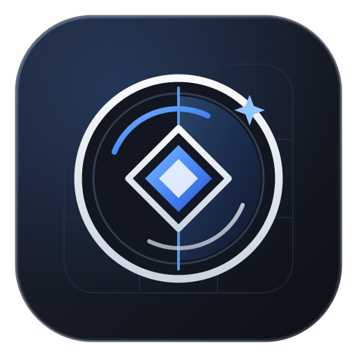
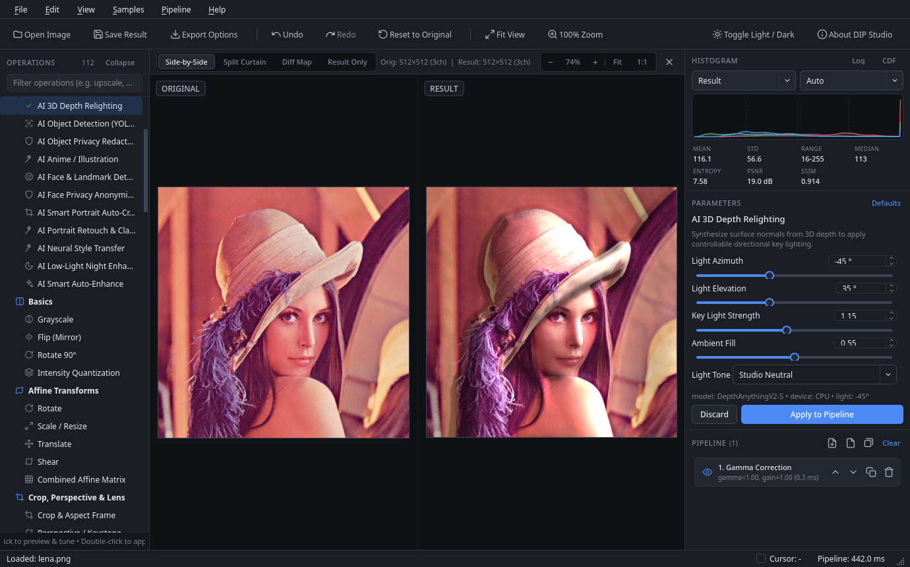
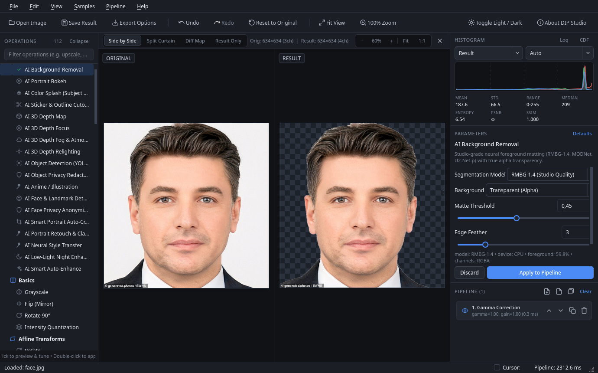
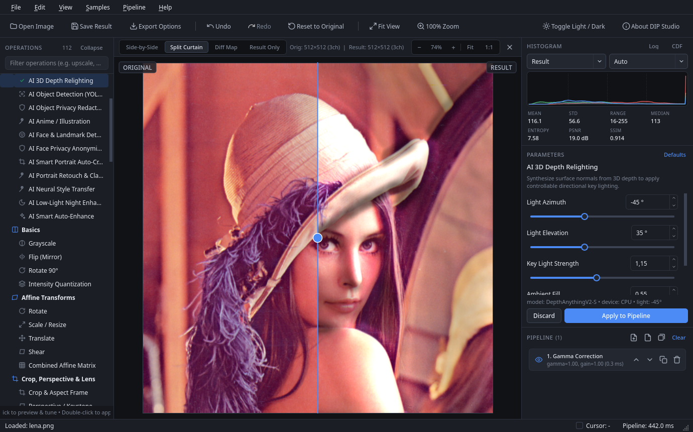
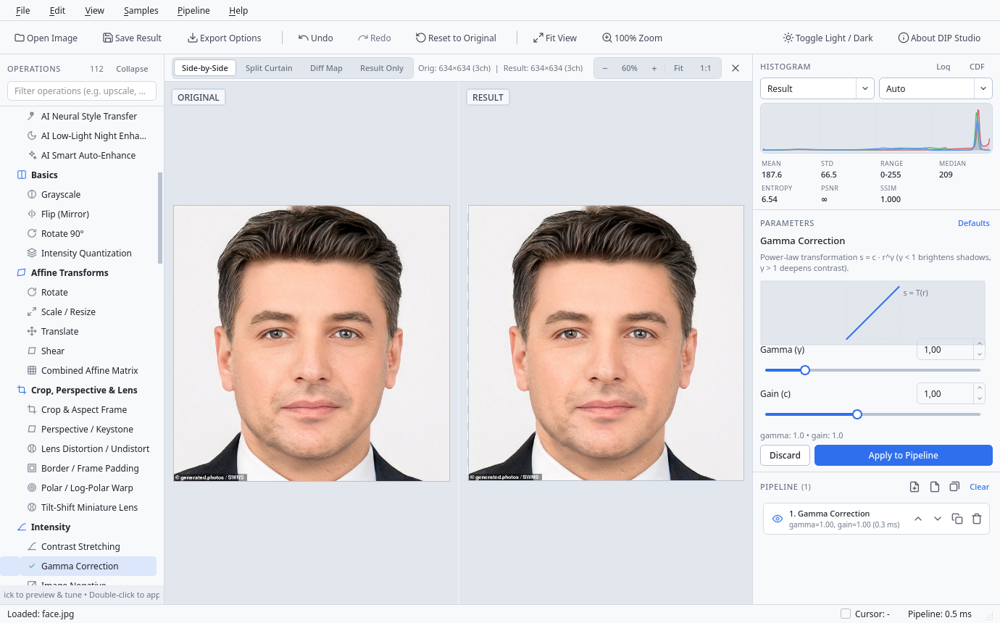

# DIP Studio: Digital Image Processing Studio 

[](https://github.com/denizsafak/dips/actions/workflows/publish-github.yml)
[](https://github.com/denizsafak/dips/releases/latest)
[](https://github.com/denizsafak/dips/releases/latest)
[](https://github.com/denizsafak/dips/releases/latest)
[](LICENSE)

**DIP Studio** (*Digital Image Processing Studio*) is a fast, non-destructive desktop image processing studio built with **Python**, **OpenCV**, **ONNX Runtime**, and **PyQt6**. From 19 lightweight bundled **AI Studio** tools (super-resolution upscaling, RMBG-1.4 background removal & die-cut sticker cutouts, color splash, 3D depth maps, optical depth focus, atmospheric depth fog & 3D key relighting, YOLOv8 object detection & privacy redaction, anime stylization, portrait bokeh, face detection, auto-crop, portrait retouch & privacy, low-light enhancement) with automatic GPU acceleration to **2D FFT frequency filtering**, **mathematical morphology**, **Wiener deconvolution**, **document scanning**, and **live histogram & PSNR/SSIM analysis**, DIP Studio puts an entire imaging laboratory inside a clean, familiar workspace.

<p align="center">
  
  
  
  
</p>

---

## How to Install

### Windows
1. Download the latest [`DIPS-windows-amd64.zip`](https://github.com/denizsafak/dips/releases/latest/download/DIPS-windows-amd64.zip).
2. Extract the archive.
3. Double-click `DIPS.exe` to launch.

### macOS
1. Download the build matching your Mac:
   - **Apple Silicon (M1/M2/M3/M4):** [`DIPS-macos-arm64.zip`](https://github.com/denizsafak/dips/releases/latest/download/DIPS-macos-arm64.zip)
   - **Intel:** [`DIPS-macos-amd64.zip`](https://github.com/denizsafak/dips/releases/latest/download/DIPS-macos-amd64.zip)
2. Extract the ZIP and move `DIPS.app` to **Applications**.

> [!NOTE]
> If macOS warns *"cannot be opened because the developer cannot be verified"*, open **System Settings → Privacy & Security** and click **Open Anyway**, or run:
> ```bash
> xattr -dr com.apple.quarantine /Applications/DIPS.app
> ```

### Linux
1. **AppImage (Universal):** Download [`DIPS-linux-amd64.AppImage`](https://github.com/denizsafak/dips/releases/latest/download/DIPS-linux-amd64.AppImage), mark executable (`chmod +x DIPS-linux-amd64.AppImage`), and double-click to run.
2. **Debian / Ubuntu / Linux Mint:** Download [`DIPS-linux-amd64.deb`](https://github.com/denizsafak/dips/releases/latest/download/DIPS-linux-amd64.deb) and install with:
   ```bash
   sudo apt install ./DIPS-linux-amd64.deb
   ```
   Installs under `/opt/dips`, adds the `dips` command, and registers a desktop launcher.
3. **Tarball:** Download [`DIPS-linux-amd64.tar.gz`](https://github.com/denizsafak/dips/releases/latest/download/DIPS-linux-amd64.tar.gz), extract, and run `./DIPS/DIPS`.

---

## Key Capabilities

<details open>
<summary><strong>112 Non-Destructive Operations across 13 Categories</strong></summary>

| Category | Included Tools |
| :--- | :--- |
| **AI Studio** *(Bundled ONNX)* | AI Super-Resolution (ESPCN 3x & 4x-UltraSharp), AI Background Removal & Sticker Cutout (RMBG-1.4, MODNet, U2-Net-p), AI Color Splash, AI Portrait Bokeh, AI 3D Depth Map, Focus, Fog & Relighting (Depth Anything V2), AI Object Detection & Object Privacy Redactor (YOLOv8n), AI Anime / Illustration (AnimeGANv2), AI Face & Landmark Detection, Face Privacy, Smart Portrait Auto-Crop & Portrait Retouch (YuNet), AI Neural Style Transfer (Mosaic / Candy), AI Low-Light Night Enhance, AI Smart Auto-Enhance |
| **Basics** | Grayscale (Rec.601, Rec.709, Avg, Lightness, R/G/B), Flip (H/V/Both), Lossless 90°/180°/270° Rotation, Bit-Depth Quantization (1–8 bit) |
| **Affine Transforms** | Arbitrary Rotation (with canvas expansion & Transparent fill), Uniform & X/Y Scale, Translation, Shear (X/Y/Both), Combined 2×3 Affine Matrix |
| **Crop, Perspective & Lens** | Interactive Crop & Aspect Frame (`1:1`, `4:3`, `16:9`, `3:2`, `4:5`, `9:16`, `21:9`), 3D Keystone Perspective, Radial Lens Distortion/Undistort, Border Padding, Polar / Log-Polar Warp, Tilt-Shift Miniature Lens |
| **Intensity** | Contrast Stretching (Min-Max, Percentile, Piecewise Linear), Gamma, Negative, Log Transform, Brightness & Contrast, Intensity-Level & Bit-Plane Slicing |
| **Spatial Filters** | Mean/Box, Gaussian, Median, Bilateral, Laplacian (magnitude, `+128`, sharpen), Sobel (X/Y/Mag/Angle), Prewitt/Scharr/Roberts, Canny, Point & Directional Line Masks, Unsharp Mask, Editable 3×3 & 5×5 Convolution Kernel |
| **Frequency Domain (FFT)** | 2D FFT Magnitude Spectrum, Ideal/Butterworth/Gaussian Low-Pass & High-Pass, Band-Pass / Band-Reject (Notch), Homomorphic Illumination Filter |
| **Histogram & Quality** | Responsive 256-bin Histogram (Result / Original / Overlay, Log, CDF), Histogram Equalization, CLAHE, Histogram Specification, **PSNR / SSIM / MSE / MAE** metrics |
| **Morphology & Threshold** | Global, Otsu (`T*` readout), Adaptive, Multi-Level / Iterative `T*`, Niblack & Sauvola Threshold; Erode, Dilate, Open, Close, Gradient, Top-Hat, Black-Hat, Boundary, Skeleton, Hole Filling, Convex Hull, Hit-or-Miss, Zhang-Suen Thinning & Pruning |
| **Noise & Restoration** | Synthetic Noise (Gaussian, S&P, Speckle, Poisson), Non-Local Means Denoising, Motion Blur, Wiener Deconvolution, Spot/Scratch Inpainting, Dark Channel Dehazing |
| **Color Spaces** | RGB / HSV / CIE LAB / YCrCb / CMY Channel Split, HSV Hue/Saturation, Color Slicing (HSV Hue Mask), YCbCr Skin Region Detector, Multi-Channel Color Edge Vector Gradient, Gray-World White Balance & RGB Gains, Photographic Temperature/Tint & Vibrance, Pseudo-Color Colormaps |
| **Tone & Stylization** | Detail Enhance (Clarity), Shadows/Highlights/Vibrance, Optical Vignette, Film & Split Toning, Pencil Sketch, Watercolor Stylization, Cartoon/Cel Shader, Chromatic Aberration |
| **Segmentation & Features** | Connected Components, Marker Watershed, K-Means Quantization, Region Growing & Quadtree Split-Merge, Corner Detectors (Harris / Shi-Tomasi / FAST), Scale-Space Blobs (LoG / DoG / DoH), Texture (LBP / Gabor / GLCM), Contours & Hu Moments, HOG, SIFT / ORB Local Descriptors, Hough Lines / Circles, Auto Document Scanner & Dewarp |

</details>

---

## Run from Source & Package

```bash
uv venv --python 3.12 .venv
source .venv/bin/activate
uv pip install .
dips
```

- **Dev & Test Dependencies:** `uv pip install -e ".[dev]"`
- **Optional NVIDIA CUDA GPU Support:** `uv pip install -e ".[gpu-cuda]"` (or `[gpu-directml]` on Windows)
- **Run Test Suite:** `QT_QPA_PLATFORM=offscreen .venv/bin/pytest -v`
- **Build Native Packages:** `.venv/bin/python scripts/build.py`
- **Release Versioning:** Update the PEP 621 `version` field in [`pyproject.toml`](pyproject.toml) and run the manual **Build & Publish DIP Studio Release** GitHub Actions workflow.

---

## License
MIT License - Copyright © 2026 **Deniz Şafak**